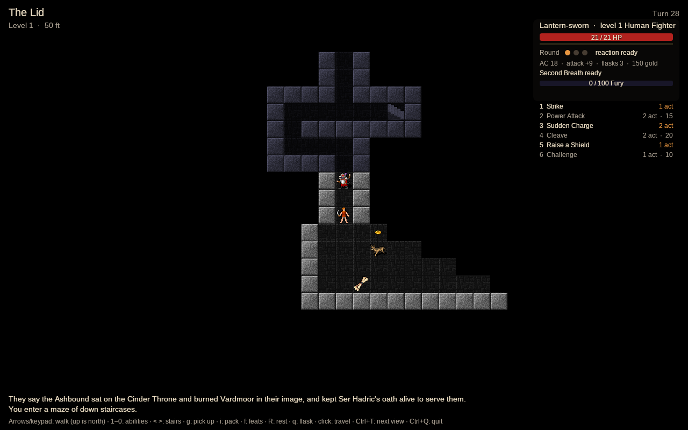

# AVAWorldOfAngBand

A turn-based dungeon crawl that joins two games: [AVABand](https://github.com/Harlock123/AVABand)'s Angband (its
dungeon generator, its turn system and its 4.2.5 data) and [AVAAshenReliquary](https://github.com/Harlock123/AVAAshenReliquary)'s
hero, rules, art and story. Ten years after the Cinder Throne, the Reliquary under Mount Cindral turns out to be only a
lid: below it a shaft goes down a hundred levels, to where the Order of the Pale Lantern first burned Ashur. You go
down it as one of the Lantern-sworn, with no Ember Heart. When you die, you stay dead.

**Status: milestone 6 of 6 ("Breadth").** The whole game is there, from Gallowmere to the Cinder of Ashur at
depth 100. Levels are generated as Angband 4.2.5 generates them and drawn isometrically in Flare's art. The hero is a
Pathfinder 2e character on AshenReliquary's rules, one of seven classes with their abilities and feats, fighting turn
by turn on Angband's energy system. All of Angband's
monsters are in, with their 91 spells and innate attacks in Pathfinder's terms, and every name Angband takes from
Tolkien is renamed for the Ashen setting. Angband's items lie on the floor with Pathfinder's runes, Gallowmere's shops
buy and sell, and the Smith etches runes. Ashen Reliquary's story goes on through five story levels, Saint Ysmere and
the Cinder, and past level 20 the hero rises through five mythic tiers. Angband's artifacts come in renamed (or as
randarts), there are daily and weekly challenges, mods, and a Legacy from an AVAAshenReliquary save. Balance bots play
it to the bottom and win. Death is final. What is left is in [the design specification](docs/SPECIFICATION.md).


## What there is so far

- **The dungeon.** Every level is made by AVABand's port of Angband 4.2.5's generator: its nine cave profiles, 500
  room templates, 162 vaults and 40 monster pits. The same game seed always makes the same game.
- **Isometric, in Flare's art.** AshenReliquary's tiles at their full size. Each wall shows a face toward the floor
  beside it, and lit rooms carry torches on their walls. Doors, stairs, rubble, magma and quartz veins and lava each
  have their own look.
- **Sight as in Angband.** What the hero sees by torchlight or in a lit room is drawn in full. What they have seen
  before is drawn dim. What they have never seen is not drawn at all.
- **Pathfinder's rules, one action at a time.** Each step or Strike is one action and one Angband turn. Three actions
  make a round:
  - the multiple attack penalty counts the Strikes in the round (−5, −10);
  - a fighter's Shield Block comes back each round.
  Every check is a d20 with four degrees of success, and the message log shows the roll: *You hit the kobold
  (14 + 9 = 23 vs AC 15): 9 slashing.*
- **All of Angband's monsters,** 623 of 4.2.5's, AVABand's ten (its seasonal ones stay out) and the story's three
  echoes, brought into
  Pathfinder's terms (the spec's section 6):
  - their level comes from their depth, and their AC, attack and saves from AshenReliquary's creature formulas at
    that level;
  - each Angband blow is a Strike, and its effect (poison, fear, paralysis, blindness, drained strength) comes with a
    save;
  - they think as Angband's do, ported from AVABand: they wake by degrees, hunt by sight, noise and scent, gather in
    packs, surround the hero in the open, lurk while the hero holds a corridor, flee when hurt, open and bash doors,
    and breed;
  - their hit points are AshenReliquary's for their level (a common monster has a quarter of Pathfinder's, a unique
    all of them), more or fewer as Angband's rank against others of their depth;
  - Angband's damage counts in full to depth 5, then for less and less (0.55 at depth 30, 0.33 at 100), and never
    more than Pathfinder's for the monster's level; their speed above normal counts for half.
- **Their spells,** all 91 of Angband's, in Pathfinder's terms:
  - bolts and arrows are attacks against AC;
  - balls, breaths and storms call for a basic Reflex save, mind blasts and wounds for a basic Will save;
  - blinding, confusion, fear, slowing and paralysis call for a save, and a worn protection turns them aside;
  - monsters heal, blink, teleport, pull the hero to them, summon their kin, shriek and darken the room.
  Laying traps, spinning webs and changing shape wait until traps, webs and shapes come into the game.
- **Angband's 25 elements as Pathfinder's damage types:** nether is void and drains, sound is sonic and stuns, shards
  slash and bleed, nexus throws the hero, chaos confuses, gravity and inertia slow, light and dark blind.
- **The art,** by monster base (the spec's section 3.4):
  - orcs, trolls, ogres, giants, kobolds and people are Flare's paper-doll body, dressed as warriors, mages, priests,
    archers or rogues, tinted and scaled;
  - dogs are Danimal's wolf; insects are Flare's ants and antlions; skeletons, zombies, wraiths and liches are
    Flare's dead;
  - dragons and hydras are its wyvern, demons and yetis its minotaur, golems its skeleton knight;
  - ghosts are drawn half seen.
  Anything with no sprite stands on the floor as its DCSS tile. Every spell flashes on its way: a bolt's streak, a
  ball's burst, a breath's cone.
- **The Ashen setting's names.** Every unique and every Tolkien coinage is renamed (`data/setting/ashen_names.json`):
  - Grip and Fang are Ash and Ember, the Ferryman's Hounds; the Nazgûl are the Nine Unburied, Ser Hadric's
    oath-knights; Balrogs are the Cinder-Born;
  - Saruman is Malachar's Shadow; Sauron is Saint Ysmere the Unburnt, and Morgoth the Cinder of Ashur;
  - mithril is moonsilver.
  A test fails if a Tolkien name would reach the screen.
- **One life.** At 0 HP, Second Breath holds the hero at 1 HP once per trip down; it comes back in town. After that,
  death is final. The hero's line goes into the Order's book of the Lantern-sworn, struck through, and the next one
  starts from Gallowmere.
- **Healing:** three flasks, filled again in town, potions, and rest (`R`) with no monster in sight.
- **Angband's items, with Pathfinder's numbers.** Things lie on the floor where the generator put them, and monsters
  drop what their Angband entries say. The items stay Angband's; what they are in Pathfinder's terms is worked out from
  them:
  - a weapon's to-hit becomes its potency rune (+1 to +3), its to-dam its striking rune, and its kind a Pathfinder
    weapon (a long sword is a d8 slashing versatile blade, a maul a d12 two-hander);
  - body armour is light, medium or heavy with its AC and Dex cap, and its to-AC is its potency;
  - a shield's Shield Block takes off as much as its hardness.
  - **42 of Angband's egos come in as runes:** slays give +1d6 against their foes, brands +1d6 of their element,
    resistances 5. Free action, courage, sight and the sustains turn blow effects aside. Speed and stealth stay on
    Angband's scales.
- **Learning what things are, as in Angband 4.2.** Potions and scrolls go by their flavours until tried, and an ego
  shows `{??}` until its runes show themselves. Each rune is learned when it shows itself (a hit, a resisted blow, a
  paralysis that never comes), and then it is known on every item.
- **Potions and scrolls:**
  - healing, curing, speed, heroism, berserk strength, resistances;
  - Phase Door, Teleportation, Light, Magic Mapping, Treasure Detection, Word of Recall, Deep Descent, Teleport Level;
  - blessings, enchantments and Identify Rune;
  - and the bad ones, which teach their flavour the hard way.
- **Gallowmere's shops,** Angband's eight with their stock tables, kept by the Ashen setting's people. They sell what
  is in the game so far and buy at half. The Hanged Man sells good things at three times the price, and your room at
  the inn keeps what you leave there. **The Smith** etches potency and striking at Pathfinder's levels, for gold.
- **The classic views.** `Ctrl+T` turns from the isometric view to AVABand's letters and then its DCSS tiles, seen from
  above.
- **Gallowmere,** the town, by day: stone shops with their names over the doors, and a wood of dead trees round them.
- **The story,** Ashen Reliquary's carried on (the spec's section 2). Each hero hears one of four rumours of how Ashen
  Reliquary ended, and Wren, at the Lantern Archive, says where to go next. Five story levels have their own room, the
  keeper of their choice, and an altar:
  - the Rot-Mother's Font at 15 (seal it, or quench your blade in it), the Drowned Library at 33 (read the last
    chapters, or leave them), the Oath Hall at 45 (free Ser Hadric, or hold him to his oath), the Brood Nest at 72 (let
    the Cinderwyrm's dam go, or smash the egg);
  - the First Pyre at 99, where Saint Ysmere keeps her vigil alone: if you read the Library you can tell her the truth,
    and if not you have to kill a saint;
  - the Cinder of Ashur at 100.
  The two quest levels have no way down until their keeper is gone, and nothing (stairs, Deep Descent, a monster's
  spell) takes the hero past them. The rumour sets which Herald's echo waits at 98. When the Cinder goes out, the
  epilogue reads every choice; then Enter lays down the lantern (the hero's line goes in the book, not struck
  through), or Escape goes on deeper.
- **Mythic tiers.** Past level 20, experience raises the hero through five mythic tiers: 10 more hit points each, and
  attack, AC and saves rising by one every other tier.
- **Seven classes, played one action at a time** (the spec's sections 4.1 and 5.1). AshenReliquary's Fighter, Champion,
  Rogue and Wizard, and three new ones from Angband:
  - the **Priest** (Wisdom, Mana): Divine Lance, Heal, Bless, Orb of Draining, Turn the Wicked, Holy Word; a
    Confessor's wards or an Inquisitor's smiting;
  - the **Druid** (Wisdom, Mana): Stinging Swarm, Lightning Strike, Barkskin, Tangling Vines, Earthquake, Storm of
    Vengeance; a Stormwarden's wind or a Thornkeeper's briars;
  - the **Blackguard** (Strength, Fury): Unholy Blow, Leap into Battle, Howl of the Damned, Berserk Strength, Maim
    Foe, Bloodbath; a Reaver's rage or a Tormentor's fear.

  Each ability takes its one to three actions and pays its Fury, Mana, Devotion or Momentum. Cooldowns run on the game's
  clock, and spells heighten with the hero's level. Weapon abilities are Strikes with more dice, feints and riders.
  Spells are spell attacks or basic saves, and wards, auras, tumbles, hiding and traps last their seconds. Keys 1 to 0
  use them, on the monster under the pointer or the nearest one. The Ranger, Necromancer and Gunslinger wait for
  companions, raised dead, bows and guns.
- **Levels and feats.** Each new level asks for its picks: a class feat, a skill feat, a general or ancestry feat, a
  skill increase (`f`). Feats give new abilities and make old ones stronger.
- **Birth.** Name, ancestry and heritage, background, class and subclass, then how the hero heard Ashen Reliquary
  ended: a rumour at random, a rumour chosen, or a **Legacy**, the ending a hero reached in an AVAAshenReliquary save
  (read from its saves folder, never written).
- **Artifacts** (the spec's section 6.3). Angband's 147, each renamed for the setting ('Ringil' is 'Coldflame'), on the
  kinds the game has. With the **randarts** birth option, Angband's generator makes a new set for the game instead,
  named from the setting's words. An activation is the game's own effect (healing, curing, speed, resistance, light,
  mapping, recall) or a one-off attack (a bolt, a ball, a drain), with Angband's recharge. Activate one from the pack.
- **Daily and weekly challenges** (AVABand's). Everyone gets the same dungeon and hero on the same day, or in the same
  week with one of seven twists:
  - Darkness, Glass Cannon, Thin Flasks, Swarm, Restless Foes, Gold Rush and Lean Times;
  - the twist turns by three a week, so none comes twice running.

  Every try goes on the day's or week's board, best first.
- **Mods** (AVABand's, with this game's layers). Each folder in the mods folder holds data files named as the game's
  own, laid over them by id. A modded monster or item comes into the game through the mod's `bridge/monsters.json` and
  `bridge/items.json`, and its names through `ashen_names.json`. The Mods window shows what each adds and switches it
  off, and "Make an example mod" writes one to copy.
- **The balance bots** (the spec's M5). A hero made ready for a depth (the spec's level for it, runes, the protections
  Angband heroes have by then, potions) dives three levels from 5, 30, 60 and 90, and one made ready for the bottom
  goes down through Saint Ysmere and the Cinder. The tests hold them to it: most dives live, and a hero ready for the
  bottom puts out the Cinder.




## Keys

In the isometric view the map is turned forty-five degrees, so keys move the hero the way they point on screen. In the
classic views up is north, as in Angband.

| | |
| --- | --- |
| Arrows, keypad, or `h` `j` `k` `l` `y` `u` `b` `n` | Walk; walk into a monster to strike it |
| `>` / `<` | Go down / up the stairs underfoot |
| `,` or keypad `5` | Stay put a turn |
| `R` | Rest until healed (stops when a monster appears) |
| `g` | Pick up what lies here (gold is picked up as you walk) |
| `1` … `9`, `0` | Use an ability: on the monster under the pointer, or the nearest one in sight |
| `f` | A new level's picks: feats and a skill increase |
| `i` | The pack: wear, take off, drink, read, activate or drop (Enter does what suits the item) |
| `q` | Drink from a healing flask |
| Click | Travel to a square you have seen, or strike a monster beside you |
| Walk into a shop's door | Its window: buy and sell; at the Smith, runework |
| Walk onto a story level's altar | Its choice |
| `Enter` / `Escape` after the Cinder | Lay down the lantern / go on deeper |
| `Escape` | Stop travelling or resting |
| `Ctrl+T` | Isometric, letters, tiles |
| `Ctrl+Q` | Leave the game (asked first: there is no saving yet) |
| Mouse wheel | Zoom |

`--seed N` on the command line plays game N again.

## Download

Builds for Windows (x64, x86, ARM64), macOS (Intel and Apple Silicon) and Linux (x64, ARM64 and 32-bit ARM) are on the
[releases page](../../releases): `latest` is the newest build of `main`. Unzip or untar it and run `AVAWorldOfAngBand`
(`AVAWorldOfAngBand.exe` on Windows). Each is a single self-contained file.

## Building

```bash
dotnet build AVAWorldOfAngBand.slnx
dotnet test AVAWorldOfAngBand.slnx
dotnet run --project src/WorldOfAngBand.App
```

.NET 10 (see `global.json`). `WORLDOFANGBAND_SHOTS=docs/images dotnet test` redraws the pictures above. See
[AGENTS.md](AGENTS.md) for how the code is put together.

## Licences and credits

- **The code** is GPL-2 ([LICENSE](LICENSE)), because AVABand's data and the code it ported from Angband are.
  AshenReliquary's own code is MIT, which may be included in a GPL-2 work.
- **The game data** in `src/WorldOfAngBand.Data/data` comes from Angband 4.2.5, by Ben Harrison, Robert Ruehlmann,
  Andi Sidwell, Nick McConnell and the Angband team (GPL-2), as AVABand converted it.
- **The art** is from [Flare](https://flarerpg.org) (CC-BY-SA 3.0), by Clint Bellanger and the Flare artists. See
  `src/WorldOfAngBand.App/Assets/Flare/LICENSE.txt` and `CREDITS.txt`.
  - The wolf is ["Wolf monsters animated"](https://opengameart.org/content/wolf-monsters-animated) (CC-BY-SA 4.0 and
    3.0), by Danimal, from Micket's CC0 mesh with Poss's fur textures (`README-wolf.txt`).
  - The classic tiles, and monsters with no Flare sprite yet, are the
    [Dungeon Crawl Stone Soup tiles](https://opengameart.org/content/dungeon-crawl-32x32-tiles) (CC0), as AVABand ships
    them (`src/WorldOfAngBand.App/tilesets/dcss`).
- **The rules** are Pathfinder 2e's, under the ORC licence, as AshenReliquary's code builds them. The Pathfinder name, setting and trademarks are
  not used.
